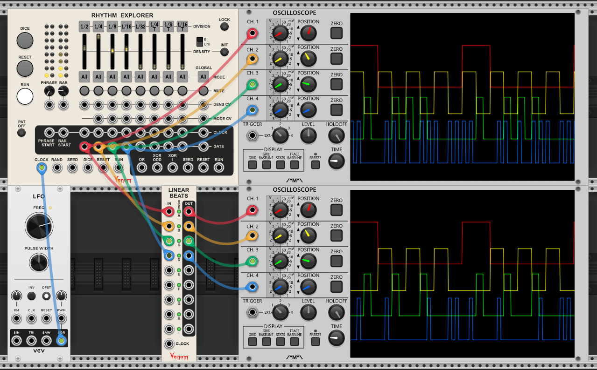

Only allow one trigger/gate to strike at a time across multiple incoming trigger/gate channels, thus converting coincident drum triggers into a linear drumming pattern.

Lower lettered inputs (toward the top) take precedence over higher lettered inputs (toward the bottom). Linear Beats is polyphonic, and lower numbered polyphonic channels take precedence over higher numbered channels.

A gate/trigger appearing at the input may or may not be passed through to the output depending on the channel mode, and whether or not a higher precedence channel transitioned to high at the same time. A lower precedence channel in Linear mode may strike a new gate while higher precedence gates are high as long as none of those higher precedence gate transitions are coincident.

For example, in the image below the top oscilloscope shows gate patterns with coincident gates. The bottom oscilloscope shows the effect of Linear Beats - lower precedence gates with coincident transitions to high are removed. Note that Rhythm Explorer has linear beats capabilities built in that this example does not use. The Linear Beats module just brings that functionality to a stand-alone module.  

Each channel has four possible modes controlled by a color coded button:
 - **Linear (green)** - Any gate will not pass through if a higher precedence gate transitioned to high at the same time. Any gate that does pass through will block lower precedence gates.
 - **All (off, dark gray)** - All gates will pass through, regardless whether higher precedence channels transitioned to high at the same time. All gates will block lower precedence gates.
 - **Non-blocking Linear (orange)** - Any gate will not pass through if a higher precedence gate transitioned to high at the same time. Gates that do pass through will ***not*** block lower precedence gates.
 - **New All (white)** - All higher precedence gates are forgotten and a new linear drumming group is started. All gates will pass through and also will block lower precedence gates.
 
There does not exist a Non-blocking All mode. If you want to allow gates through that do not block lower precedence channels, then simply put that channel toward the top and start a new linear drumming group with a New All mode below.

A channel mode applies identically to all polyphonic channels on a given lettered channel.

All inputs are Schmitt triggers that transition to high when the level rises to 1V or above, and transition to low when the level falls to 0.1V or lower. The outputs are 10V for high, and 0V for low.

If Linear Beats is not clocked, then it is dependent on all trigger/gate transitions being exactly in sync down to the sample level.

If the input gates are not guaranteed to be in sync, then you can add a clock input to effectively force all triggers/gates to be in sync with the timing "grid" of the clock. Inputs are only checked for transition to high or low whenever the clock transitions to high. The clock should be delayed at least as much as the most delayed input. If you want outgoing gates to be 50% duty cycle, then the clock should run at least twice as fast as your fastest incoming channel.

If Linear Beats is bypassed, then all inputs are passed through unchanged to the outputs.
