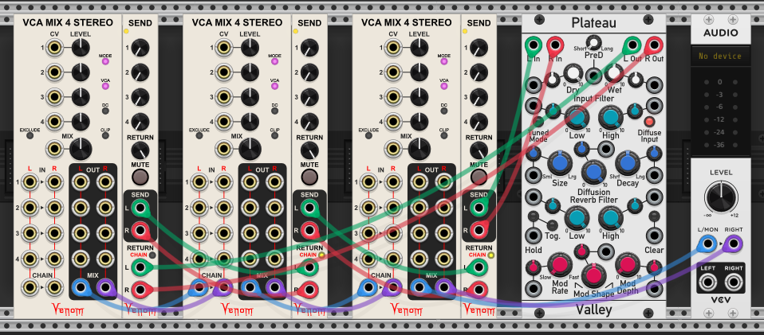

Provides an auxilliary mix of the four mix inputs that can be sent to the Send output(s), and optionally returned to the Return input(s)

Each numbered knob can attenuate the channel to between 0% and 100%, before the channels are mixed and sent to the Send output(s).

The Return input(s) are attenuated by the Return knob before being mixed in with the final Mix module mix. The return is mixed in prior to applying the final Level gain at the main Mix module.

Both Send oututs and Return inputs support polyphonic cables.

The Mute button sets the Send output(s) to constant 0V when lit.

Both Left and Right Send and Return inputs and outputs are used when the main Mix module is stereo ([Mix 4 Stereo](Mix4Stereo.md), or [VCA Mix 4 Stereo](VCAMix4Stereo)).

If the main Mix module is not stereo ([Mix 4](Mix4.md), or [VCA Mix 4](VCAMix4.md)), then the Right Send output is constant monophonic 0V, and any right Return is ignored.

The position of the Send module in a chain of Mix expanders is important. Expanders to the left of the Send expander affect the Send output. Expanders to the right of the Send expander do not affect the Send output.

At most 16 Send modules can be used with a single mix module. The maximum is fewer than 16 if other expander types are used in addition to the Send modules.

The Return inputs have a Chain button that changes the behavior of the expander for use with chained mixers. If enabled, then the Return knob is disabled, and the Left Return and Right Return inputs receive the chained Send from a prior Aux Send expander. For example, suppose you have three VCA Mix 4 Stereo modules chained together named Mix1, Mix2, and Mix3, and each has an Aux Send module, named Send1, Send2, and Send3. Leave the chain option off on Send1, and enable chain on Send2 and Send3. Patch the Send1 Send outputs to Send2 Return (Chain) inputs, and Send2 Send outputs to Send3 Return (Chain) inputs. Finally patch the Send3 Send outputs to the effect module inputs, and the effect outputs to the Send1 Return inputs. The Send1 Return knob controls the return level, and the Send3 Mute button can be used to mute the entire send chain.

More general information is available at the [Mix Expanders page](mix_expanders.md).