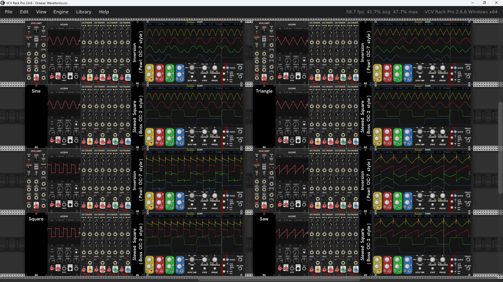

An old school octave effect in the style of the Pearl OC-7 and Boss OC-2 analog effect pedals. Feed in a monophonic signal with a regular periodic waveform and it can generate a mix consisting of the original input plus 1 octave up, 1 octave down, and 2 octaves down. Just like the old pedals, an input mix of multiple pitches will lead to problems with tracking. 

### Polyphony
Unlike the old hardware pedals, this module can work with chords using VCV style polyphony as long as there is only one pitch per polyphonic channel.

The number of output channels is strictly controled by the main IN input.

Monophonic CV inputs are replicated to match the IN channel count.

Polyphonic CV inputs with fewer channels use 0V for the missing channels. Any extra channels are ignored.

### MODE (Sub-octave mode) button
Controls the method used to generate sub-octaves. Each method has its own distinctive sound.
- **Inversion (Pearl)** ***(yellow, default)*** - the method used by the Pearl OC-7
- **Square (Boss)** ***(blue)*** - the method used by the Boss OC-2

### OVER (Oversample) button
Controls the amount of oversampling for controlling digital aliasing.
- **x2** ***(yellow, default)***
- **x4** ***(green)***
- **x8** ***(blue)***

The default x2 oversampling is adequate for almost all applications. If working with very high frequencies then x4 or x8 might be appropriate.

### Mix controls
Each mix component has a large knob plus a CV input with small attenuverter knob. The large knob sets the base amount ranging from 0% to 100%. The bipolar CV is scaled at 10% per volt, and is inverted and/or attenuated by the small attenuverter knob. The final effective amount is the sum of the scaled CV plus the base knob, clamped to a value between 0% and 100%.

#### +1 (Octave +1 mix) knob and CV input
Controls the amount of one octave up in the final mix.

The upper octave is produced by fully rectifying the input and then amplifying the result by a factor of two. The result is then converted back to a bipolar signal. This works well with sine and triangle waveforms. For saw waveforms it produces a triangle output in the same octave, and square waveforms hardly produce any output at all.

#### 0 (Dry mix) knob and CV input
Controls the amount of the original input in the final mix.

#### -1 (Octave -1 mix) knob and CV input
Controls the amount of one octave down in the final mix.

The method for producing the -1 octave depends on the current mode.
- **Inversion** - A comparator determines the zero crossing points to establish unit wave cycles. Alternating cycles are inverted to create the sub-octave.
- **Square** - A comparator converts the input into a pulse wave, and a flip flop subdivides the frequency by a factor of two. Slew is applied to round out the sound a bit, filtering out some of the higher harmonics of a square wave. An envelope follower for the input coupled with a VCA controls the -1 octave volume to match the input before applying the mix amount.

#### -2 (Octave -2 mix) knob and CV input
Controls the amount of two octaves down in the final mix.

The method for producing the -2 octave depends on the current mode.
- **Inversion** - Alternating cycles of the -1 octave are inverted and the result is summed with the original -1 octave.
- **Square** - The -1 octave passes through a second flip flop and slew is applied. An envelope follower for the input coupled with a VCA controls the -2 octave volume to match the input before applying the mix amount.

### DRIVE knob and CV input
Controls the amount of gain applied to the final mix. The large knob establishes the base gain ranging from 0 (off) to 10 (x10). The CV is scaled one for one and inverted and/or attenuated by the small attenuverter knob. The final effective gain is the sum of the scaled CV plus the base knob, clamped to a value between 0 and 10.

High gain levels result in saturation via the tanh limiter at the output.

### IN input
The input is AC coupled to make sure the input is bipolar. This is a requirement of the algorithms used to produce the octaves.

### OUT output
The final output is limited to +/-6 V via a saturating tanh function.

### Example octave waveforms
Oscilloscope traces showing the waveforms produced for each octave using different modes and inputs.

For each input and mode combination, the original waveform is shown in red to the left, and to the right are the four resultant waveforms:  
yellow = +1, red = 0, green = -1, blue = -2

### Standard Venom Context Menus
[Venom Themes](plugin.md#themes), [Custom Names](plugin.md#custom-names), and [Parameter Locks and Custom Defaults](plugin.md#parameter-locks-and-custom-defaults) are available via standard Venom context menus.

### Bypass

The signal input is copied to the output when Octaver is bypassed.
