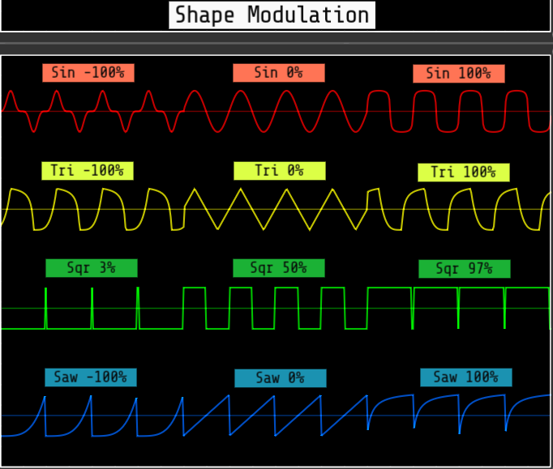
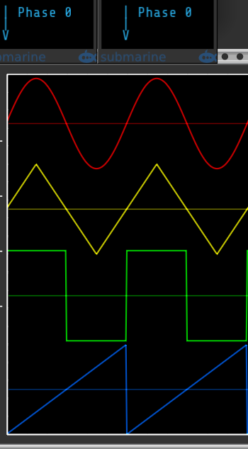

A polyphonic oscillator with a robust array of features for the mad scientist sound designers amongst us, including available oversampling to give clean anti-aliased output regardless which functions are combined.

### Summary of features

- Modes for audio, low frequency, and 0 Hz carrier linear FM
- The audio and low frequency modes can also be setup for triggered, retriggered, or gated one shot mode
- The triggered one shot mode can generate the undertone/subharmonic series
- Oversampling options to control aliasing
- Simultaneous outputs for Sine, Triangle, Square, and Saw waveforms, plus a highly configurable Mix
- Each waveform has controls/inputs for shape, phase, offset, and level
- The mix also has controls/inputs for shape (saturation or folding), global phase, offset, and level
- Even waveform (fundamental + even harmonics) available via saw morphing shape mode
- All inputs can be driven at audio rates, and nearly all can be oversampled
- All inputs support polyphony
- Level controls with configurable VCAs support AM and ring mod.
- Independent controls/inputs for exponential FM and true linear through 0 FM
- Linear FM input defaults to AC coupled, with an option for DC coupled
- Audio rate modulation of phase provides functionality often incorrectly referred to as through 0 linear FM.
- Independent inputs for hard sync (reset phase to 0), and 3 modes of soft sync (triggered reverse, gated reverse, phase reset conditional on phase threshold)
- Octave control
- Square pulse width range can be 0-100% or 3-97%
- Optional DC offset removal for the outputs

Omri Cohen has created an excellent overview of VCO Lab. It uses an older version of VCO Lab with a slightly different layout, but it is still instructive.

https://www.youtube.com/watch?v=iTE15_leyXQ

Global controls and inputs are generally to the left.

The grid of controls, inputs, and outputs to the right control each waveform as well as the overall mix. One major exception is the Mix Phase controls on the far right are actually global phase controls.

### Polyphony
VCO LAB is fully polyphonic - All inputs can process polyphonic signals.

The number of output channels is the maximum number of channels found across all inputs.

Monophonic inputs are replicated to match the number of output channels. Polyphonic inputs that have fewer channels use constant 0V for missing channels.

### Reset Poly (Reset Polyphony count) button
Momentarily forces all outputs to be monophonic - useful when the input polyphony count is reduced while the VCO Lab has feedback. The reset forces the correct output poly count to be computed. Without the Reset Poly button it would require temporary removal of all feedback to restore the correct poly count.

### FRQ (Frequency Mode) button
This color coded button controls the overall mode of the oscillator
- **Audio frequency** (white - default)
- **Low frequency** (orange)
- **0 Hz carrier** (yellow)
- **Triggered audio one shot** (light blue)
- **Retriggered audio one shot** (dark blue)
- **Gated audio one shot** (green)
- **Retriggered LFO one shot** (pink)
- **Gated LFO one shot** (purple)

In 0 Hz carrier mode the oscillator is stalled if there is no bias, and requires linear FM input or phase CV input to produce a signal. Some of the controls and inputs have alternate behavior in this mode (labeled in an alternate color). Exponential FM has no effect unless the bias is non-zero.

Phase distortion synthesis can be explored via the 0 Hz carrier mode. Setting the phase input attenuator to 40% will cause a 10V phasor change to exactly produce one wave cycle. The smoothest results will be achieved if all anti-aliasing is disabled for both the driving phasor, as well as the VCO Lab in 0 Hz carrier mode. For VCO Lab this means turning oversampling off, and disabling DPW anti-alias suppression.

If using any of the one shot modes, then the oscillator will not produce any output until it receives a trigger or gate at the Sync input.
 - Triggered one shots will output exactly one complete cycle and then stop until the next trigger is received. If the cycle has not yet completed when a sync trigger is received, then the trigger is ignored. This works well for creating undertone or subharmonic series!
 - Retriggered one shots will output one complete cycle and then stop until the next trigger is received. If another trigger is received before the cycle completion, then the wave will be reset to phase 0 and retriggered.
 - Gated one shots work the same as retriggered except they only output as much of a single wave cycle as fits within the high gate period.

Regardless what mode is chosen, the full oscillator frequency range is accessible via CV modulation.

Whenever the frequency mode changes, the oversample rate is initialized to a default value. LFO modes always default to oversampling off. Audio and 0 Hz carrier modes initially default to x4 oversampling. A module context menu option is available to change the default audio and 0 Hz carrier oversample rate.

### Frequency limits

Like any digital oscillator, there is a hard upper frequency limit at 50% of the sample rate called the Nyquist frequency. However, VCO Lab does not limit any V/Oct voltage, so the oscillator may attempt to produce higher frequencies. If oversampling is not enabled, then the high frequencies are reflected back below the Nyquist frequency. If oversampling is enabled, then the amplitude of high frequencies is attenuated dramatically as the Nyquist frequency is approached.

Similarly, the module does not limit the low frequencies either. But here again there is a practical limit due to the limitations of single precision floating point numbers. When at very low frequencies, the oscillator may stall and cease oscillating. The stall point varies depending on the VCV engine sample rate, and the amount of oversampling. The stall point rises as the engine sample rate rises and/or as the oversampling rises.

### OVR (Oversample) button
This color coded button controls how much oversampling is applied to control aliasing of audio output.
- **Off** (dark gray - low frequency mode default)
- **x2** (yellow)
- **x4** (green - initial audio mode and 0 Hz carrier mode default)
- **x8** (light blue)
- **x16** (dark blue)
- **x32** (purple)

There is also a context menu option to select the quality of the filters used for oversampling.

See [Anti-aliasing via oversampling](plugin.md#anti-aliasing-via-oversampling) for more information.

Note that oversampling is CPU intensive, so best to use the lowest amount of oversampling that gives satisfactory results.

To further reduce CPU usage, oversampling may be disabled for individual inputs that are not being modulated at audio rates. Inputs that support oversampling have a context menu option to enable or disable oversampling, and an LED next to the port to indicate the current oversampling state:
- dark gray indicates that oversampling is off, or there is no input, so the current port setting is not applicable
- yellow indicates the input is being oversampled
- red indicates the input is not being oversampled

### DPW alias supression
Square and Saw waves have the most high frequency harmonic content that can lead to more aliasing. To further reduce aliasing, VCO Lab uses DPW (Differentiated
Polynomial Waveforms) when generating saw or pulse waves in audio mode.

DPW does not work well at low frequencies due to single precision floating point limitations, so DPW processing is automatically disabled when producing low frequency audio. This point varies depending on the sample rate and amount of oversampling.

DPW is always disabled when using any of the LFO modes, regardless the frequency. DPW is also disabled if the shape modulation is set to a morphing waveform, or one of the rectify modes.

There is a context menu option to disable DPW entirely for all audio modes.

### DC (DC block) button
This color coded button controls whether a high pass filter is applied to remove DC offset from all outputs
- **Off** (dark gray - default)
- **On** (yellow)

### FREQ/BIAS (Frequency/Bias) knob
Sets the base frequency of the oscillator. The knob range varies depending on the Frequency Mode and the current selected Octave. Normally the knob uses an exponential scale, but in 0 Hz carrier mode it is a linear Bias with a very small range.

There is a module context menu option to measure the frequency in BPM (beats per minute) instead of Hz when using any of the LFO modes.

Below are the knob ranges by mode when the Octave is at 0. Note that the Octave does not modify the bias frequency when in 0 Hz carrier mode.

|Mode|Minimum|Default|Maximum|
|---|---|---|---|
|Audio frequency|16.352 Hz (C0)|261.63 Hz (C4)|4186 Hz (C8)|
|Low frequency|0.125 Hz (7.5 BPM)|2 Hz (120 BPM)|32 Hz (1920 BPM)|
|0 Hz carrier bias|-8 Hz|0 Hz|8 Hz|

When in 0 Hz carrier mode, a 0 Hz bias produces a static linear FM sound. A non 0 bias provides a rhythmic motion to the sound - the higher the bias magnitude, the faster the rhythm.

### Octave/FM Range knob
When in audio or low frequency mode, the Octave knob adds or subtracts octaves to the Frequency knob.

When in 0 Hz carrier mode the knob sets the range for the linear FM depth. Low frequency modulation requires a smaller range, and higher frequency modulation a higher range to achieve the same degree of FM "folding"

### Soft Sync input
The small unlabeled button to the right of the Soft Sync label controls the mode of soft sync.
- **Triggered reverse mode** ***(off, default)*** - The leading edge of an incoming trigger reverses the current direction of the waveform. The fundamental output frequency follows the syncing signal one octave lower. This mode is of limited use if the frequency is below the syncing frequency. A hard sync always resets the direction to forward.
- **Gated reverse mode** ***(yellow)*** - A high gate puts the waveform in reverse mode. A low gate puts the waveform in forward mode. The fundamental output frequency follows the syncing signal in the same octave. Asymmetric high vs low gate times gives motion to the timbre. This mode is of limited use if the frequency is below the syncing frequency. A hard sync never changes the direction.
- **Phase threshold mode** ***(green)*** - Same as a hard sync except the phase is only reset to 0 if the wave has progressed at least 270 degrees since the last hard or soft sync. Sounds the same as hard sync if the pitch is at or above the syncing signal. Generates subharmonics if the pitch is below the syncing signal.

The trigger and gate detection is implemented as a Schmitt trigger that goes high above 2V and goes low below 0.2V. Those thresholds allow for both unipolar and bipolar trigger signals to be used. A module context menu option allows you to change to a 0V high threshold and -2V low threshold, which only works for bipolar inputs, but synchronizes the trigger with the 0 crossing point. There is also an option to use +/- 50uV thresholds, which also only works for bipolar inputs, but is helpful for generating symmetric high vs low gate times.

This port supports oversampling that can be disabled via the port context menu.

### Exp FM (Exponential frequency modulation) knob
This knob sets the depth of exponential frequency modulation.

### Exp FM (Exponential frequency modulation) input
This input is for exponential FM CV.

This port supports oversampling that can be disabled via the port context menu.

### Exp FM (Exponential frequency modulationi) Depth input
This bipolar input can attenuate the Exp FM depth. A value of 10V represents 100%, and -10V inverts the depth at 100%.

This port does not support oversampling.

### Lin FM (Linear frequency modulation) knob
This knob sets the depth of through 0 linear frequency modulation

### Lin FM (Linear frequency modulation) input
This input is for linear FM CV.

By default this input is AC coupled. There is a port context menu to enable DC coupled mode, which can save a small amount of CPU if you know that your input does not have any DC offset. A small LED to the lower right glows red when the input is DC coupled.

By default the linear FM is through-zero. There is a port context menu to disable through-zero mode. A small LED to the lower left glows red when the through-zero is disabled. Note that 0 Hz carrier frequency mode ignores this setting - it is always through-zero.

This port supports oversampling that can be disabled via the port context menu.

### Lin FM (Linear frequency modulation) Depth input
This input can attenuate the Lin FM depth. A value of 10V represents 100%, and -10V inverts the depth at 100%

This port does not support oversampling.

### V/Oct / Bias input
When in Audio or Low Frequency mode this input modulates the oscillator frequency at a scale of 1 volt per octave.

When in 0 Hz Carrier mode the input modulates the linear Bias at 2 Hz per volt.

This port does not support oversampling.

### Sync (Hard Sync) input
The Sync input resets the master oscillator phase to 0 upon the leading edge of an incomming trigger.  
If using any of the one shot modes, the Sync is used to trigger the start of a wave cycle.

If synced by an audio signal, the fundamental output frequency follows the frequency of the syncing signal. Hard sync is of limited use if the frequency is lower than the syncing signal because the output is increasingly attenuated as the frequency drops.

The sync trigger detection is implemented as a Schmitt trigger that goes high above 2V and goes low below 0.2V. Those thresholds allow for both unipolar and bipolar trigger signals to be used. A module context menu option allows you to change to a 0V high threshold and -2V low threshold, which only works for bipolar inputs, but synchronizes the trigger with the 0 crossing point. There is also an option to use +/- 50uV thresholds, which also only works for bipolar inputs.

This port supports oversampling that can be disabled via the port context menu.

### Waveform and Mix Grid

The grid to the right contains columns of controls, inputs, and outputs for the four waveforms (sine, triangle, square, saw), and the mix.

The grid rows consist of Shape modulation, Phase modulation, Offset modulation, Level modulation, and Output.

For each modulation there is a base control knob plus a CV input and bipolar attenuator knob (attenuverter). The base modulation value is summed with the attenuated CV to get the final modulation amount.

All grid inputs support oversampling that can be disabled via the port context menu.

#### Waveform Shape Modulation
All four waveforms get different shape modulation. Each has a color coded Shape Mode button to determine the type of modulation used.

##### Sin Shape Mode button
- **log/exp** (yellow - default)
- **J-curve** (orange)
- **S-curve** (purple)
- **Rectify** (light blue)
- **Normalized Rectify** (dark blue)
- **Morph SQR <--> SIN <--> SAW** (pink)
- **Limited PWM 3%-97%** (green)
- **Skew** (red)

##### Tri Shape Mode button
- **log/exp** (yellow - default)
- **J-curve** (orange)
- **S-curve** (purple)
- **Rectify** (light blue)
- **Normalized Rectify** (dark blue)
- **Morph SIN <--> TRI <--> SQR** (pink)
- **Limited PWM 3%-97%** (green)
- **Skew** (red)

##### Sqr Shape Mode button
Controls the range of pulse width modulation, or the type of waveform morphing
- **Limited PWM 3%-97%** (yellow - default)
- **Full PWM 0%-100%** (orange) Values of 0% or 100% yield constant low or high output, with no oscillation
- **Morph TRI <--> SQR <--> SAW** (purple)

##### Saw Shape Mode button
- **log/exp** (yellow - default)
- **J-curve** (orange)
- **S-curve** (purple)
- **Rectify** (light blue)
- **Normalized Rectify** (dark blue)
- **Morph SQR <--> SAW <--> EVEN** (pink)
- **Limited PWM 3%-97%** (green)
- **Full PWM 0%-100%** (red)

J-curve and S-curve are based on sigmoidal functions. The J-curve uses only half (positive or negative portion) of the sigmoidal function.

Rectify yields only 5 volts peak to peak (5 VPP) when shape is 100% or -100%.

Normalized Rectify attempts to keep the output 10 VPP regardless the shape value. It also shifts the output to keep it bipolar, prior to applying any offset.

The even waveform with the Saw Morph option is the same as what is produced by the Befaco Even module. It consists of the fundamental plus even harmonics.

The PWM percentages for sine, triangle, and saw waveforms represent the relative width of the positive portion of the bipolar waveform. The negative width always grows or shrinks in the opposite direction such that positive width plus negative width always adds to 100%, and the overall frequency remains constant.

##### Sin, Tri, Saw Shape CV inputs
The initial release of VCO Lab required 20 volts peak to peak CV to cover the entire shape range for Sin, Tri, and Saw. Starting with V 2.9.0 these ports now default to 10 volts peak to peak covering the entire range. These ports have a context menu option to revert to old behavior.

Below is a summary of the wave shaping when using the default (yellow) mode for all four waveforms.

|Waveform|Negative modulation|No modulation|Positive modulation|
|---|---|---|---|
|**Sine**|exponential response|mathematical sine|logarithmic response|
|**Triangle**|exponential rise, logarithmic fall|linear triangle|logarithmic rise, exponential fall|
|**Square**|< 50% pulse width|50% pulse width|> 50% pulse width|
|**Saw**|exponential ramp|linear saw|logarithmic ramp|

#### Mix Shape Modulation button
The mix also has a color coded Shape Mode button
- **Sum (No shaping)** (yellow)
- **Saturate Sum** (orange - default)
- **Fold Sum** (purple)
- **Average (No shaping)** (light blue)
- **Saturate Average** (green)
- **Fold Average** (dark blue)

Summed shaping is best for smooth bipolar shape modulation and maximum shaping effect

Average shaping is best for maintaining 10V peak to peak output, as well as consistent unipolar output when applying Mix offset.

#### Waveform Phase Modulation
The image below shows the phase relationship between the four waveforms when no phase modulation is applied.  

The phase of each waveform can be modulated relative to the other waveforms. This can have a dramatic impact on any resultant mix.

Each waveform can also be independently modulated at audio rates to achieve what is commonly mislabeled as linear through 0 frequency modulation. The effect is similar to, but definitely not the same as true through 0 frequency modulation.

When in 0 Hz carrier mode, phase modulation can be used to explore the world of phase distortion synthesis. Set the attenuator to 40% so that a 10V phasor delta equates to exactly one waveform cycle. Anti-aliasing on either the incoming phasor or the 0 Hz carrier will lead to unwanted distortion at phase discontinuities. So to get smooth results, oversampling should be off and DPW disabled when doing phase distortion synthesis.

#### Global (Mix) Phase Modulation
The Mix phase modulation is actually a global modulation that is applied to all waveforms prior to mixing.

Adjusting the global phase can have a profound impact on the sound of soft sync.

Of course the global phase can be modulated at audio rates so that all waveforms get the same phase modulation.

#### Waveform Offset Modulation
Each waveform may be offset by as much as +5 or -5 volts, typically to achieve a unipolar output. Note that waveform offsets are only applied to the individual waveform outputs - they are not included in the mix output.

Offsets are applied before any level adjustment.

#### Mix Offset Modulation
The mix also can be offset by as much as +5 or -5 volts, again typically to achieve a unipolar output. If trying to obtain a consistent unipolar output, it is often best to use one of the average options for the Mix Shape mode.

The offset is applied before any level adjustment

#### Waveform and Mix Level control

The sum of the Level knob and the attenuated CV is clamped to +/- 100% by default via hard clipping. There is a module context menu option to disable the limit for the entire module.

Each Level CV port has two context menu options in addition to the "Disable oversampling" option
- **VCA unity = 5V**: By default this option is disabled, and 10V equates to 100%. If enabled, then 5V equates to 100%. This is especially useful for ring modulation. The LED above and left of the port glows yellow when this option is enabled.
- **Bipolar VCA (ring mod)**: By default this option is disabled, and the VCA is unipolar, meaning negative CV is ignored. If enabled, then the VCA responds to both negative and positive CV, which allows for ring modulation. The LED below and left of the port glows yellow when this option is enabled.

#### Waveform Level Assignment
Each waveform has a color coded Lvl Asgn (Level Assign) button that controls how the waveform level attenuation is applied.
- **Mix Output** (yellow - default) - The level determines how much of the waveform is added to the mix. The waveform output will be unattenuated.
- **Waveform Output** (dark blue) - The level attenuates the waveform output, and the waveform is excluded from the mix.
- **Both Waveform and Mix Output** (green) - The level determines how much of the waveform is added to the mix, and also attenuates the waveform output.

#### Outputs
Each waveform has its own dedicated output, plus there is a Mix output.

### Standard Venom Context Menus
[Venom Themes](plugin.md#themes), [Custom Names](plugin.md#custom-names), and [Parameter Locks and Custom Defaults](plugin.md#parameter-locks-and-custom-defaults) are available via standard Venom context menus.

### Bypass
All outputs are monophonic 0V if the module is bypassed.
